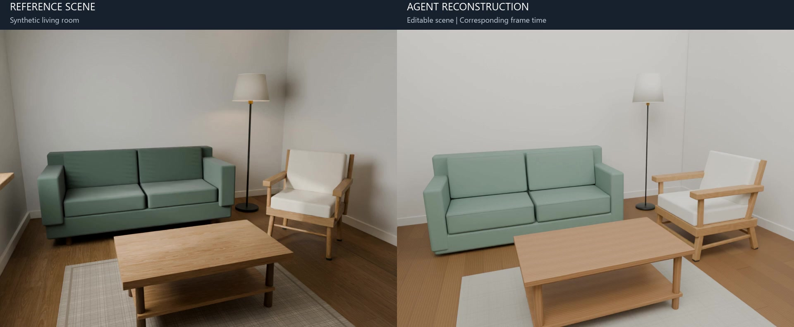
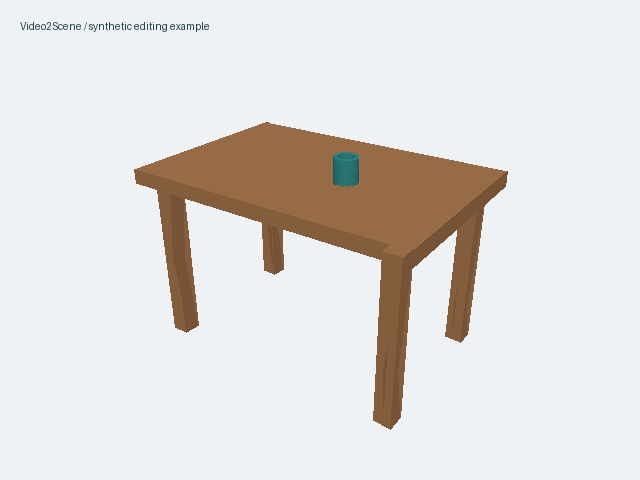

# Video2Scene

**Turn video into editable 3D scenes, refine individual objects through conversation, and export to Blender.**

[中文](README.md) · [Installation](docs/INSTALLATION.md) · [Demo](docs/DEMO.md) · [Workflow](PIPELINE.md)

Video2Scene is an early personal open-source project. Its local Pi workbench combines image observations, ViPE camera/depth estimates, SAM instance masks, human layout review, and bounded object authoring with an independent critic. Scene changes are validated and saved as revisions.

## Synthetic living room: reference and reconstruction

[](https://github.com/yosoro114514/Video2Scene/releases/download/v0.1.0/livingroom-comparison.mp4)

**[▶ Watch the 30-second comparison](https://github.com/yosoro114514/Video2Scene/releases/download/v0.1.0/livingroom-comparison.mp4)** · [Case notes](docs/SHOWCASE.md) · [Modeling workflow](docs/WORKFLOW.md)

This run refined and saved 18 modeling targets, with Blender and GLB exports reopened for validation. The comparison presents room layout, major furniture and editable output at corresponding frame times. Camera and lighting conditions are documented in the case notes.

**v0.1.0 is a public preview**, intended for local use and development feedback. [Release and downloads](https://github.com/yosoro114514/Video2Scene/releases/tag/v0.1.0)

Features include numeric object editing, undo/redo, conversational edits, rolling object refinement (default 3, configurable 1–4 tasks), shared model/Blender resource limits, persistent recovery and serial scene commits. A finished asset can be saved while other objects continue. Object concurrency is a scheduling limit, not a promise of simultaneous model calls or speedup. Scale is generally estimated; hidden geometry may be inferred.

## Try the editor

The original synthetic tabletop sample needs Python 3.11–3.13 and Blender. It uses CPU rendering/builds and makes no model calls. The image below is a procedural example, not a video reconstruction result.



From the source checkout, on Windows:

```powershell
python -m venv .venv
.venv\Scripts\python.exe -m pip install -e .
Copy-Item video2scene.example.toml video2scene.local.toml
```

Set `blender` in the local TOML file to your executable, or leave `"blender"` if it is on PATH.

```powershell
.venv\Scripts\python.exe -m video2scene check --mode demo
.venv\Scripts\python.exe -m video2scene demo
```

On Linux, use `.venv/bin/python` and `cp` instead. Open the printed URL, select the cup, edit its X position, save, and export the saved revision. The same output directory resumes the scene on restart. [Walkthrough](docs/DEMO.md)

## Full video workflow

Install the separate GPU environments and model dependencies as described in [Installation](docs/INSTALLATION.md), then:

```shell
npm ci --prefix tools/pi-runtime --ignore-scripts --no-audit --no-fund
python -m video2scene check --mode workbench
python -m video2scene workbench --port 8794
```

The complete development workflow has run on Windows with Ubuntu 22.04 under WSL2 and an NVIDIA GPU. Native Linux launching has been adapted but a clean Linux end-to-end GPU/model run is not yet verified. macOS full reconstruction is unverified.

The current Pi bridge uses a file-backed Codex ChatGPT login. It cannot consume keyring-only credentials or refresh the shared login itself. Both Pi and the account must support the configured model. Model access and subscription limits are external prerequisites, and the local diagnostic does not verify them. [Configuration](docs/CONFIGURATION.md)

## Development

```shell
python -m pip install -e '.[dev]'
python -X utf8 -m pytest -q
node --test tests/pi_workflow/transport.test.mjs tests/pi_workflow/retry.test.mjs
node tests/editor_v1/test_state.cjs
```

Tests use isolated fixtures; optional Blender and historical-data checks skip when their prerequisites are absent. Full model/GPU acceptance is separate. [Contributing](CONTRIBUTING.md) · [Architecture](docs/ARCHITECTURE.md) · [Troubleshooting](docs/TROUBLESHOOTING.md)

## License

Original project code is under [Apache-2.0](LICENSE). Bundled and external components retain their own terms, including separate model licenses. See [Third-party notices](THIRD_PARTY_NOTICES.md). The source includes a curated showcase cover; the comparison video is a Release attachment. User videos, weights, credentials, conversations and raw runtime outputs are excluded. The full workflow sends selected images and text to the configured model service. See [Security and data handling](SECURITY.md).
