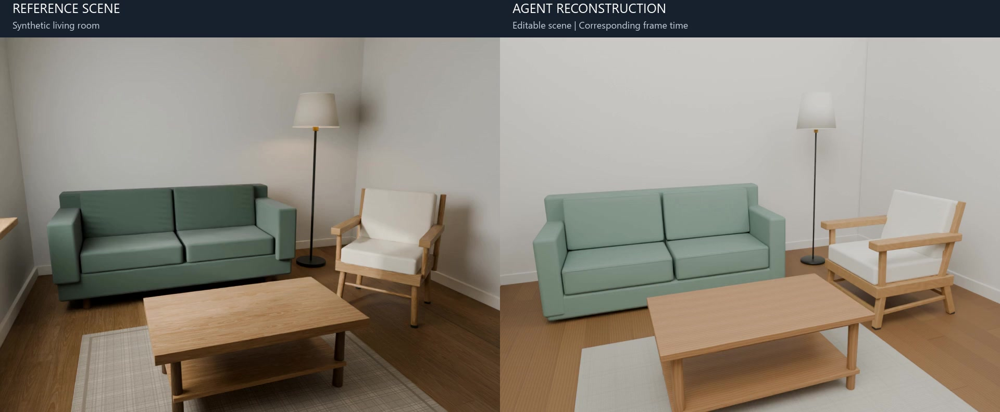
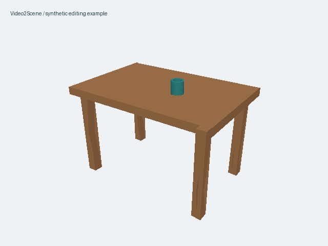

# Video2Scene

**从视频构建可编辑的三维场景，通过对话调整布局、逐对象精修，导出到 Blender。**

[English](README.en.md) · [安装](docs/INSTALLATION.md) · [示例教程](docs/DEMO.md) · [完整工作流](PIPELINE.md) · [文档目录](docs/README.md)

Video2Scene 是一个持续开发的个人开源项目。当前推荐入口是本地 Pi 工作台：查看源视频，结合 ViPE 相机／深度和 SAM 实例分割生成白模，由用户核对布局，再逐对象建模、复核、验证并保存。

## 合成客厅：参考场景与 Agent 重建

[](https://github.com/yosoro114514/Video2Scene/releases/download/v0.1.0/livingroom-comparison.mp4)

**[▶ 观看 30 秒对比视频](https://github.com/yosoro114514/Video2Scene/releases/download/v0.1.0/livingroom-comparison.mp4)** · [案例说明](docs/SHOWCASE.md) · [建模工作流](docs/WORKFLOW.md)

展示房间布局、主体家具与逐对象精修后的可编辑场景。该次运行完成 18 个建模目标，导出的 Blender／GLB 已重开验证。视频按对应时间展示参考场景与重建场景；相机和光照条件见案例说明。

当前版本为 **v0.1.0 公开预览版**，适合本地体验和开发反馈。[发布与下载](https://github.com/yosoro114514/Video2Scene/releases/tag/v0.1.0)

## 可以做什么

- 导入单目 RGB 视频，保留原始帧与相机／掩码的对应关系。
- 在浏览器中选择对象、修改位置与尺寸，保存版本并撤销／重做。
- 用对话提出修改或精修请求；布局确认后才进入对象精修。
- 持续调度对象精修，默认并发 3、可选 1–4；完成一个即可进入保存，并补入下一个任务。模型与 Blender 另有共享资源限额。
- 逐场景串行验证和保存，保留已完成资产，支持逐对象暂停、任务恢复与连接重试。
- 导出保存版本对应的 `.blend` 和 `.glb`，继续在 Blender 中编辑。

这是面向静态室内场景的早期工具。尺度通常是估计值，遮挡部分可能包含推断；效果与视频覆盖、分割质量、几何后端和模型能力有关。[能力与结果边界](RESULTS.md)

## 先体验编辑与导出

仓库提供一张桌子和一个杯子的**原创合成示例**。它用于体验编辑、保存与导出，不是视频重建结果，不需要模型账号、模型权重或 CUDA。保存和导出需要本机 Blender，使用 CPU。



在源码目录内，使用 Python 3.11–3.13（建议 3.12）：

```powershell
python -m venv .venv
.venv\Scripts\python.exe -m pip install -e .
Copy-Item video2scene.example.toml video2scene.local.toml
```

编辑 `video2scene.local.toml`，将 `blender` 设置为本机 Blender 可执行文件路径。若 Blender 已在 PATH 中，保留 `"blender"` 即可。

```powershell
.venv\Scripts\python.exe -m video2scene check --mode demo
.venv\Scripts\python.exe -m video2scene demo
```

打开终端显示的地址（默认端口 8795）。选择杯子，修改 X 位置，保存，再点击“导出当前 Blender / GLB”。重新启动同一示例目录会读取已保存版本。[详细步骤与 Linux 命令](docs/DEMO.md)

## 从自己的视频开始

完整工作流需要额外安装 Node.js、Pi、Codex、ViPE 和 SAM 3.1，并准备兼容的 GPU 环境。已经运行过的开发配置为 Windows + WSL2 Ubuntu 22.04 + NVIDIA GPU；原生 Linux 路径已适配，但完整 GPU／模型闭环尚未在干净 Linux 主机验收。macOS 完整重建未验证。

按照[安装说明](docs/INSTALLATION.md)准备环境后：

```powershell
npm.cmd ci --prefix tools/pi-runtime --ignore-scripts --no-audit --no-fund
.venv\Scripts\python.exe -m video2scene check --mode workbench
.venv\Scripts\python.exe -m video2scene workbench --port 8794
```

打开终端显示的 `/workflow/` 页面，导入视频并说明想构建的场景。白模生成后，核对、修改并采用布局，再选择对象精修或执行整屋精修。[完整流程](PIPELINE.md)

模型由 `video2scene.local.toml` 配置。当前默认值来自开发环境，不保证每个账号或 Pi 版本都能使用。Pi 必须识别该模型，Codex 账号也必须有访问权限；认证失败会保留任务状态。[配置与认证限制](docs/CONFIGURATION.md)

## 项目结构

| 位置 | 职责 |
| --- | --- |
| `video2scene/pi_workflow/` | 工作台、持久任务、滚动调度、恢复与 Pi 工具循环 |
| `video2scene/agent_scene/` | 场景证据、几何提议与对象作者／复核 |
| `video2scene/scene_state/` | 版本、候选、提交与恢复 |
| `video2scene/asset_backend/` | Blender 构建、渲染与导出 |
| `video2scene/validation_v1/` | 支撑、碰撞、边界与证据检查 |
| `video2scene/editor_v1/` | 本地三维编辑器 |
| `tools/pi-runtime/` | 固定版本的 Node / Pi 桥接 |
| `tests/` | CPU 回归、协议与可选 Blender／浏览器测试 |

软件包名暂保留 `video2scene-lite`。推荐从本源码仓库安装；工作台还需要仓库中的 Node 桥接和 Blender worker。旧几何 CLI 和实验适配代码仍保留，当前使用路线以本页为准。[架构说明](docs/ARCHITECTURE.md)

## 开发与反馈

```powershell
.venv\Scripts\python.exe -m pip install -e ".[dev]"
.venv\Scripts\python.exe -X utf8 -m pytest -q
node --test tests/pi_workflow/transport.test.mjs tests/pi_workflow/retry.test.mjs
node tests/editor_v1/test_state.cjs
```

测试不调用真实模型。部分历史数据回归和 Blender 检查在依赖缺失时会跳过；完整 GPU／模型运行另行验收。[本次验收](docs/RELEASE_VALIDATION.md) · [贡献指南](CONTRIBUTING.md) · [故障排查](docs/TROUBLESHOOTING.md) · [近期计划](docs/ROADMAP.md)

## 许可与数据

自有代码按 [Apache-2.0](LICENSE) 发布。随附的 Three.js 与 AHa-3D 代码保留各自声明。ViPE、SAM、可选 YOLO、Blender 和下载模型适用各自许可证／条款；项目许可证不替代这些条件。[第三方清单](THIRD_PARTY_NOTICES.md)

源码包包含经整理的案例封面与说明；完整对比视频作为 Release 附件分发。用户视频、模型权重、登录缓存、聊天日志和原始运行目录不随源码发布。模型工作流会向所配置的模型服务发送所选图像和文字；运行数据保存在本地输出目录。[数据与运行边界](SECURITY.md)
