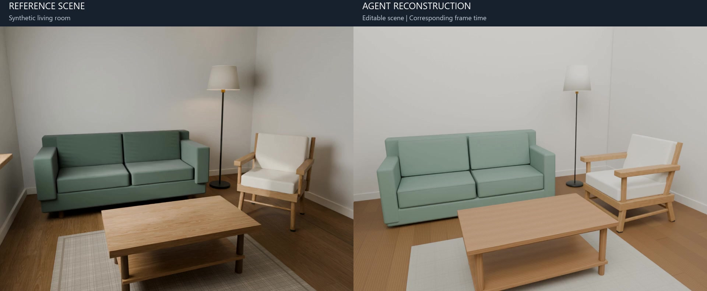

# 合成客厅：参考场景与 Agent 重建

**[观看完整 30 秒视频](https://github.com/yosoro114514/Video2Scene/releases/download/v0.1.0/livingroom-comparison.mp4)** · [发布页](https://github.com/yosoro114514/Video2Scene/releases/tag/v0.1.0) · [建模工作流](WORKFLOW.md)

这个案例展示主体家具、房间布局和逐对象精修后的可编辑结果。左侧为参考场景，右侧为 Agent 重建场景。公开视频仅更新了标题栏，保留原比较的场景画面、相机轨迹与帧时间。

## 运行与交付

| 项目 | 本例记录 |
| --- | --- |
| 输入 | 单目 RGB 合成室内视频 |
| 几何 | ViPE 300 帧密集输入 |
| 实例证据 | SAM 使用 120 个观察帧 |
| 人工步骤 | 用户核对并采用白模布局 |
| 精修结果 | 18 个建模目标逐件复核、验证和保存；最终 head 18 |
| 输出 | Blender 与 GLB；已完成导出与重开检查 |
| 对比视频 | 30 秒，10 FPS，300 帧，1920 × 792，H.264，无音轨 |

此次重建流程只接收 RGB 视频，参考场景的真值几何和相机未提供给重建流程。结果包含模型推断的几何与材质。完整运行记录保留在开发工作区，公开摘要与媒体哈希见[案例清单](assets/livingroom-showcase.json)。

## 观看条件

两侧按对应帧时间同步。参考场景采用其原相机，重建场景采用 ViPE 估计相机，经捕获坐标到场景坐标的原有映射进行显示。对比没有使用真值相机重新拟合重建结果；两侧照明不同。

本片适合观察空间布局、对象结构和跨视角表现，不作为逐像素外观精度或真实尺寸精度的测量。视频中的房间是合成案例。

## 并发记录

本例成功作者调用的峰值并发为 2，场景保存峰值为 1；18 次保存中有 10 次与其他对象的作者调用重叠。这说明运行中存在生成与保存重叠。没有同场景顺序运行的耗时基线，因此不报告加速倍数。

## 素材与使用

参考室内场景由本项目程序搭建，使用 Poly Haven 的 `oak_veneer_01`、`rough_linen`、`wool_boucle` 材质和 `residential_garden` HDRI。这些素材由上游按 [CC0](https://polyhaven.com/license) 提供；感谢 Poly Haven。公开媒体按本项目许可证分发，素材原有许可不变。[第三方声明](../THIRD_PARTY_NOTICES.md)

下载视频可直接查看。体验实际编辑、保存与导出，使用[独立桌杯示例](DEMO.md)；使用自己的视频需要[完整环境](INSTALLATION.md)。该案例没有承诺在不同模型、硬件和输入上产生相同结果。

## English summary

The video compares a synthetic reference living room with an editable Agent reconstruction. The run used RGB video, dense ViPE geometry, SAM instance evidence, human layout acceptance, object authoring and independent critique. Eighteen targets were saved and the Blender/GLB exports were reopened for validation. Corresponding frame times are shown; the reference and reconstruction use their respective cameras and different lighting. This is a qualitative scene demonstration, not a photometric accuracy metric or a speedup benchmark.
